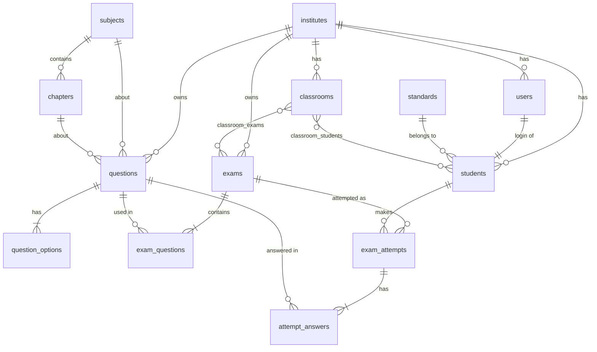

# Pariksha Backend – Online Exam & Institute Management REST API

An intermediate-level backend project for Java freshers, built with the stack that is current in 2026:

| Layer | Technology |
|-------|-----------|
| Language | **Java 21** (records, text blocks, pattern matching, virtual threads) |
| Framework | **Spring Boot 3.5** (Spring MVC, Spring Data JPA, Spring Security 6) |
| API style | **REST** + **Swagger / OpenAPI 3** docs, RFC-7807 *Problem Details* errors |
| Auth | **JWT** (stateless) + **role based access** (ADMIN / TEACHER / STUDENT) |
| Database | **MySQL 8** (use **MySQL Workbench** to explore) |
| Schema | **SQL scripts** (`schema.sql` + `data.sql`) run by Spring on startup |
| Build | Maven |
| Tests | **JUnit 5 + Mockito** (+ AssertJ assertions) |

It is a clean re-design of the uploaded `InstituteManagement` + `Parikshadb.sql` project
(old: Spring Boot 2.3, Java 8, hand-written JDBC repositories, multi-module Maven).

---

## 1. What the system does

An institute runs online tests for its students.

1. **Admin** registers the institute, adds teachers and students.
2. **Teacher** builds a **question bank** (MCQ, subject / chapter / standard / difficulty).
3. **Teacher** creates an **exam** from questions (marks + negative marking), publishes it and **assigns it to a classroom**.
4. **Student** logs in, sees assigned exams, **starts** (timer + deadline enforced on the server), **submits** – the answers are **auto-evaluated**.
5. **Student** sees result, rank and answer review. **Teacher** sees leaderboard and per-question analytics.

### Role matrix

| Feature | ADMIN | TEACHER | STUDENT |
|---|:--:|:--:|:--:|
| Register institute, update institute | ✅ | – | – |
| Manage teachers | ✅ | – | – |
| Manage students / classrooms | ✅ | ✅ | – |
| Question bank, exams, reports | ✅ | ✅ | – |
| Take exams, see own results | – | – | ✅ |

Every query is automatically scoped to the **institute of the logged-in user** (multi-tenancy), so one institute can never read another one's data.

---

## 2. Run it (5 minutes)

### Prerequisites
* JDK **21**, Maven **3.9+** (IntelliJ IDEA has Maven built in)
* **MySQL 8** running locally + **MySQL Workbench**

### Steps
1. Open **MySQL Workbench** → connect to your local server (default user `root`).
2. *(Optional)* open `database/01_schema.sql`, `database/02_master_data.sql` and run them to see the tables in Workbench.
   You can skip this – the app creates the `pariksha_db` database and all tables itself from `src/main/resources/schema.sql`.
3. If your MySQL password is not `root`, set it (or edit `src/main/resources/application.yml`):
   ```bash
   # Linux / macOS
   export DB_USERNAME=root
   export DB_PASSWORD=your_password
   # Windows PowerShell
   $env:DB_USERNAME="root"; $env:DB_PASSWORD="your_password"
   ```
4. Start the API:
   ```bash
   mvn spring-boot:run
   ```
5. Open **http://localhost:8080/swagger-ui.html**
6. In Workbench press the refresh icon in *SCHEMAS* → `pariksha_db` → you will see all tables with demo data.
   Use `database/03_practice_queries.sql` to practise SQL (joins, group by, window functions).

### Demo accounts (created automatically on first start)

| Role | Email | Password |
|------|-------|----------|
| ADMIN | admin@demo.com | Admin@123 |
| TEACHER | teacher@demo.com | Teacher@123 |
| STUDENT | student1@demo.com … student5@demo.com | Student@123 |

**How to call secured APIs in Swagger:** `POST /api/v1/auth/login` → copy `accessToken` → click **Authorize** → paste the token.
More ready-made requests are in `api-requests.http` (IntelliJ HTTP Client / VS Code REST Client).

### Run tests
```bash
mvn test
```

---

## 3. Project structure (package-by-feature)

```
src/main/java/com/pariksha
├── config/        SecurityConfig, OpenApiConfig, AppConfig (Clock + JPA auditing)
├── security/      JwtService, JwtAuthenticationFilter, AuthUser, 401/403 JSON handlers
├── common/        BaseEntity, PageResponse, custom exceptions, GlobalExceptionHandler
├── auth/          register-institute, login, me
├── institute/     institute profile
├── user/          User entity, teacher management
├── student/       student profile + CRUD + search/pagination
├── academic/      standards, subjects, chapters (master data)
├── question/      question bank (+ options)
├── exam/          exam creation, publishing (DRAFT → PUBLISHED → ARCHIVED)
├── classroom/     classrooms, assign students & exams
├── attempt/       start / submit / auto-evaluation / results / leaderboard / analytics
└── seed/          demo data seeder
```
Each feature follows **Controller → Service → Repository → Entity**, with request/response **DTO records** (entities are never exposed).

---

## 4. Database design



**To see this inside Workbench:** `Database → Reverse Engineer…` → select `pariksha_db` → you get the EER diagram.

### How the old `Parikshadb` maps to the new schema

| Old table(s) | New table | What changed |
|---|---|---|
| INSTITUTE_MASTER | `institutes` | snake_case, unique code |
| USR_USER_MASTER, EddyTechUser | `users` | one table, BCrypt hash (old: custom salt+hash), unique e-mail |
| Student | `students` | linked to `users`, soft delete, FK constraints |
| Standard / Subject / Chapter / Topic | `standards`, `subjects`, `chapters` | proper FKs; Topic left out to keep scope intermediate |
| Question, OptionSet, OptionMeta, QuestionExplanation | `questions`, `question_options` | explanation merged into `questions`, one correct option |
| Test, TestQuestion, Section | `exams`, `exam_questions` | DRAFT/PUBLISHED lifecycle, marks per question |
| Classroom, ClassroomStudent, ClassroomTest | `classrooms`, `classroom_students`, `classroom_exams` | many-to-many join tables |
| TestResult, TestResultAnswer | `exam_attempts`, `attempt_answers` | one attempt per student per exam (`UNIQUE`) |
| TestAnalysis | computed on demand (`/exams/{id}/analytics`) | no stale data to maintain |
| TestAssignment, StudentFeedbackMaster, TEST_REPORT_QUESTION, QuestionMeta | – | candidates for the "next steps" below |

---

## 5. API overview (all under `/api/v1`)

| Area | Endpoints |
|---|---|
| **Auth** | `POST /auth/register-institute` · `POST /auth/login` · `GET /auth/me` |
| **Institute** | `GET /institutes/me` · `PUT /institutes/me` |
| **Teachers** | `POST /teachers` · `GET /teachers` |
| **Students** | `POST /students` · `GET /students?search=&page=&size=` · `GET/PUT/DELETE /students/{id}` |
| **Master data** | `GET/POST /standards` · `GET/POST /subjects` · `GET/POST /subjects/{id}/chapters` |
| **Questions** | `POST /questions` · `GET /questions?subjectId=&chapterId=&difficulty=&search=` · `GET/PUT/DELETE /questions/{id}` |
| **Exams** | `POST /exams` · `GET /exams?status=` · `GET/PUT/DELETE /exams/{id}` · `POST /exams/{id}/publish` · `POST /exams/{id}/archive` |
| **Classrooms** | `POST /classrooms` · `GET /classrooms` · `GET /classrooms/{id}` · `POST /classrooms/{id}/students` · `POST /classrooms/{id}/exams` · `DELETE …/students/{sid}` · `DELETE …/exams/{eid}` |
| **Student exam flow** | `GET /student/exams` · `POST /student/exams/{id}/start` · `POST /student/exams/{id}/submit` · `GET /student/results` · `GET /student/results/{examId}` |
| **Reports** | `GET /exams/{id}/leaderboard` · `GET /exams/{id}/analytics` |

Errors always look like this (RFC 7807):
```json
{ "type": "about:blank", "title": "Validation failed", "status": 400,
  "detail": "One or more fields are invalid",
  "errors": { "email": "must be a well-formed email address" },
  "timestamp": "2026-10-19T10:15:30Z", "path": "/api/v1/students" }
```

### Important business rules (good interview talking points)
* Only **DRAFT** exams can be edited/deleted; a **PUBLISHED** exam is frozen and can be assigned to classrooms.
* A student may start only inside the exam window and only if the exam is assigned to one of their classrooms.
* The deadline is `min(startedAt + duration, exam end time)` and is enforced **on the server** (60 s grace on submit).
* Refreshing the page **resumes** the same attempt (same deadline). One attempt per student (DB `UNIQUE` + service check).
* Marking: `+positive` correct, `-negative` wrong, `0` skipped. Correct answers are **never sent** to the student before submission.
* Rank uses competition ranking (equal scores share a rank: 1, 2, 2, 4).
* Result visibility: immediately, or only after the exam window ends (`showResultImmediately = false`).

---

## 6. Concepts you practise in this project

* Layered architecture, DTO pattern, Java **records**
* Spring Data JPA: relationships (`@ManyToOne`, `@OneToMany`, `@ManyToMany`), JPQL, pagination, `@EntityGraph`, soft delete, transactions
* Bean Validation (`@Valid`, `@NotBlank`, `@Email` …)
* Spring Security 6: `SecurityFilterChain`, custom JWT filter, BCrypt, `@PreAuthorize`, CORS
* Global exception handling with `@RestControllerAdvice` + `ProblemDetail`
* MySQL SQL scripts: constraints, indexes, joins, subqueries, transactions (`database/03_practice_queries.sql`)
* OpenAPI/Swagger, environment-based configuration, unit testing with JUnit 5 + Mockito

---

## 7. Next steps (turn it into a portfolio-grade project)

1. **Scheduled auto-submit** – `@Scheduled` job that submits expired `IN_PROGRESS` attempts.
2. **Refresh tokens** and logout / token revocation.
3. **Integration tests** with Testcontainers (MySQL) and `@WebMvcTest` + Spring Security Test.
4. **Redis caching** for the question bank (the original project used Redis).
5. **Bulk import** of questions from Excel/CSV, image upload for questions (S3 / local storage).
6. **Sections** and **topics** (tables `Section`, `Topic` from the old DB), student feedback & "report a question".
7. Email / WhatsApp notification when a result is published.
8. Rate limiting on `/auth/login`, audit columns (`created_by`).
9. Add a frontend (React / Angular) that consumes this API.

---

## 8. Troubleshooting

| Problem | Fix |
|---|---|
| `Access denied for user 'root'` | set `DB_PASSWORD` env var (step 3) |
| `Communications link failure` | MySQL is not running / wrong port (default 3306) |
| `Unsupported class file major version` | you are not on JDK 21 (`java -version`) |
| Tables look wrong after editing `schema.sql` | drop the `pariksha_db` schema in Workbench and restart (schema.sql only creates missing tables) |
| 401 on every call | click **Authorize** in Swagger and paste only the token (no "Bearer ") |
| Lombok errors in IDE | install the Lombok plugin and enable *annotation processing* |
