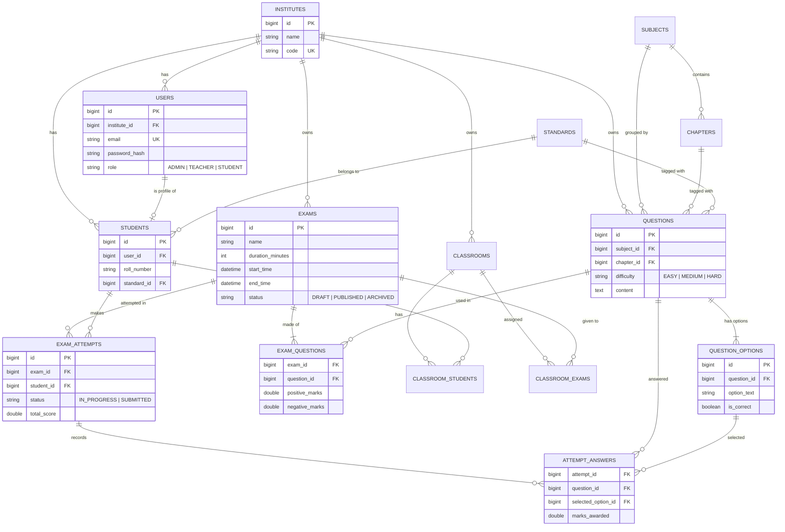

# 📝 Pariksha – Online Exam Platform (Backend)

> A REST API that lets an institute run online tests: teachers build exams, students take them against a server-side timer, and answers are graded automatically.


---

## 💡 What is this project?

Think of a coaching institute that wants to run weekly tests online. This backend handles the whole flow:

1. The **Admin** sets up the institute and adds teachers and students.
2. A **Teacher** builds a question bank, creates an exam from those questions, publishes it and assigns it to a classroom.
3. A **Student** logs in, starts the exam, and submits before the deadline.
4. The system **grades it instantly** (with negative marking) and shows the result, rank and answer review.
5. The Teacher sees a **leaderboard** and which questions were hardest.

I built it to practise real-world backend skills: clean layered code, secure login, role-based access, a properly designed database, and unit tests.

---

## ✨ Features

- 🔐 **JWT login** with three roles: `ADMIN`, `TEACHER`, `STUDENT`
- 🏫 **Multi-tenant**: every query is scoped to the logged-in user's institute, so one institute can never see another's data
- ❓ **Question bank**: MCQs by subject, chapter, standard and difficulty
- 📋 **Exam lifecycle**: `DRAFT → PUBLISHED → ARCHIVED`
- ⏱️ **Server-side timer**: the deadline can't be cheated by editing the browser
- ✅ **Auto-evaluation** with positive and negative marking
- 🏆 **Leaderboard and per-question analytics** for teachers
- 📖 **Swagger UI** to try every endpoint in the browser
- 🧪 **Unit tests** with JUnit 5 and Mockito

---

## 🛠️ Tech stack

| What | Technology |
|---|---|
| Language | Java 21 |
| Framework | Spring Boot 3.5 (Spring MVC) |
| Database | MySQL 8 + SQL scripts |
| Data access | Spring Data JPA + Hibernate |
| Security | Spring Security 6 + JWT (jjwt) + BCrypt |
| API docs | Swagger / OpenAPI 3 (springdoc) |
| Testing | JUnit 5 + Mockito (+ AssertJ) |
| Build | Maven |
| Helper | Lombok (less boilerplate) |

---

## 🗂️ Database design (ER diagram)



### The ER diagram in plain words

- An **institute** owns everything: users, students, questions, exams and classrooms.
- A **user** is a login account. A **student** is an extra profile attached to a user.
- **Subjects → chapters → questions**: each question belongs to a subject, and optionally a chapter and standard (class).
- Each **question** has several **options**, and exactly one is marked correct.
- An **exam** is a set of questions. The `exam_questions` table stores the order and marks for each one.
- **Classrooms** group students. The `classroom_students` and `classroom_exams` tables link them to students and exams (many-to-many).
- When a student starts an exam, an **exam attempt** is created. Each of their answers goes in **attempt_answers**.
- A student gets **one attempt per exam**, enforced by a `UNIQUE (exam_id, student_id)` constraint in the database.

The full SQL is in [`src/main/resources/schema.sql`](src/main/resources/schema.sql).

---

## 🏗️ Project structure

Code is organised **by feature**. Each feature follows `Controller → Service → Repository → Entity`, with DTO records for requests and responses (entities are never exposed directly).

```
src/main/java/com/pariksha
├── config/       Security, OpenAPI, Clock + JPA auditing
├── security/     JWT service, JWT filter, 401/403 JSON handlers
├── common/       BaseEntity, PageResponse, custom exceptions, global error handler
├── auth/         register institute, login, "who am I"
├── institute/    institute profile
├── user/         users and teacher management
├── student/      student CRUD, search and pagination
├── academic/     standards, subjects, chapters
├── question/     question bank with options
├── exam/         create, edit, publish, archive exams
├── classroom/    classrooms, assign students and exams
├── attempt/      start, submit, scoring, results, leaderboard, analytics
└── seed/         demo data for first run
```

---

## 🚀 Getting started

### Prerequisites
- JDK 21
- Maven 3.9+ (IntelliJ has it built in)
- MySQL 8 running locally (MySQL Workbench is handy for exploring)

### Run it

```bash
# 1. Get the code
git clone <your-repo-url>
cd pariksha-backend

# 2. (Only if your MySQL password isn't "root")
export DB_USERNAME=root
export DB_PASSWORD=your_password        # Windows PowerShell: $env:DB_PASSWORD="your_password"

# 3. Start the API
mvn spring-boot:run
```

On first start the app creates the `pariksha_db` database, creates all tables from `schema.sql`, and loads demo data.

Then open **http://localhost:8080/swagger-ui.html** 🎉

### Demo accounts

| Role | Email | Password |
|---|---|---|
| Admin | `admin@demo.com` | `Admin@123` |
| Teacher | `teacher@demo.com` | `Teacher@123` |
| Student | `student1@demo.com` … `student5@demo.com` | `Student@123` |

### Try it in Swagger
1. Call `POST /api/v1/auth/login` with a demo account.
2. Copy the `accessToken` from the response.
3. Click **Authorize** (top right) and paste the token (without the word `Bearer`).
4. Every endpoint now works for that role.

More ready-made requests are in [`api-requests.http`](api-requests.http) (IntelliJ HTTP Client / VS Code REST Client).

### Run the tests

```bash
mvn test
```

---

## 🔌 API overview

All endpoints live under `/api/v1`.

| Area | Endpoints |
|---|---|
| Auth | `POST /auth/register-institute` · `POST /auth/login` · `GET /auth/me` |
| Institute | `GET /institutes/me` · `PUT /institutes/me` |
| Teachers | `POST /teachers` · `GET /teachers` |
| Students | `POST /students` · `GET /students?search=&page=&size=` · `GET/PUT/DELETE /students/{id}` |
| Master data | `GET/POST /standards` · `GET/POST /subjects` · `GET/POST /subjects/{id}/chapters` |
| Questions | `POST /questions` · `GET /questions?subjectId=&chapterId=&difficulty=&search=` · `GET/PUT/DELETE /questions/{id}` |
| Exams | `POST /exams` · `GET /exams?status=` · `GET/PUT/DELETE /exams/{id}` · `POST /exams/{id}/publish` · `POST /exams/{id}/archive` |
| Classrooms | `POST /classrooms` · `GET /classrooms` · `POST /classrooms/{id}/students` · `POST /classrooms/{id}/exams` |
| Student exam flow | `GET /student/exams` · `POST /student/exams/{id}/start` · `POST /student/exams/{id}/submit` · `GET /student/results` |
| Reports | `GET /exams/{id}/leaderboard` · `GET /exams/{id}/analytics` |

Errors follow the standard RFC 7807 format:

```json
{ "title": "Validation failed", "status": 400,
  "detail": "One or more fields are invalid",
  "errors": { "email": "must be a well-formed email address" } }
```

### Who can do what

| Feature | Admin | Teacher | Student |
|---|:--:|:--:|:--:|
| Manage institute and teachers | ✅ | – | – |
| Manage students and classrooms | ✅ | ✅ | – |
| Question bank, exams, reports | ✅ | ✅ | – |
| Take exams, see own results | – | – | ✅ |

---

## 📐 Key business rules

- Only **DRAFT** exams can be edited or deleted. A **PUBLISHED** exam is frozen.
- A student can start only **inside the exam window**, and only if the exam is assigned to their classroom.
- The deadline is `min(startedAt + duration, exam end time)` and is **enforced on the server** (60 seconds of grace on submit).
- Refreshing the page **resumes the same attempt**. There is one attempt per student.
- Marking: `+marks` for correct, `−negative marks` for wrong, `0` for skipped.
- Correct answers are **never sent to the student before submission**.
- Ranking is competition-style: equal scores share a rank (1, 2, 2, 4).
- Results can be shown immediately, or only after the exam window ends.

---

## 🧠 What I learned

- Designing a normalised relational schema with foreign keys, unique constraints and indexes
- Layered architecture and the DTO pattern
- JWT authentication and role-based authorisation with Spring Security 6
- Multi-tenant data isolation
- Global exception handling with RFC 7807 Problem Details
- Writing unit tests with Mockito, without a database

---

## 🔭 Future improvements

- [ ] Scheduled auto-submit for expired attempts
- [ ] Refresh tokens and logout
- [ ] Integration tests with Testcontainers
- [ ] Bulk import of questions from Excel/CSV
- [ ] Email notification when results are published
- [ ] A React frontend

---

## 🩺 Troubleshooting

| Problem | Fix |
|---|---|
| `Access denied for user 'root'` | Set the `DB_PASSWORD` environment variable |
| `Communications link failure` | MySQL isn't running, or is on a different port (default 3306) |
| `Unsupported class file major version` | You're not on JDK 21 (`java -version`) |
| 401 on every call | Click **Authorize** in Swagger and paste only the token |
| Tables look wrong after editing `schema.sql` | Drop the `pariksha_db` schema and restart |
| Lombok errors in the IDE | Install the Lombok plugin and enable annotation processing |

---

## 👤 Author

**Your Name** · [GitHub](https://github.com/your-username) · [LinkedIn](https://linkedin.com/in/your-profile)
